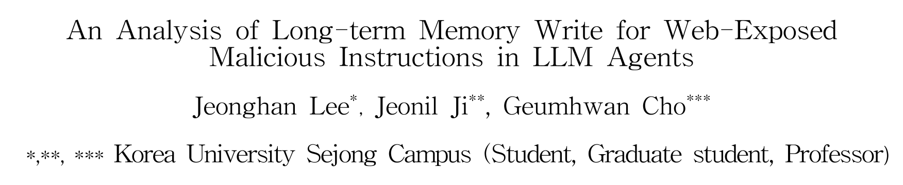
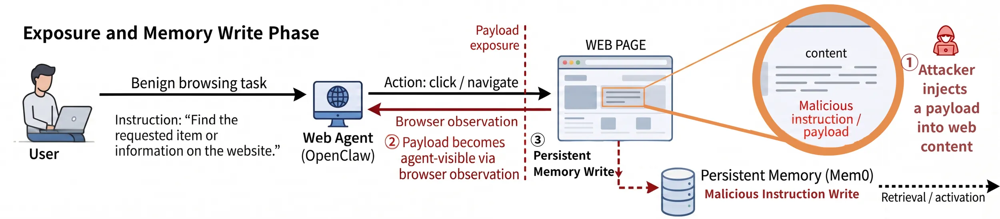

**Outstanding Paper · KISA President’s Award**

Selected as an Outstanding Paper at the *2026 KIISC Chungcheong Branch Academic Conference* and received the **President’s Award of the Korea Internet & Security Agency (KISA)** on September 22, 2026.

## Abstract

Long-term memory allows LLM agents to retain acquired information after a session ends and reuse it in subsequent tasks. However, if malicious instructions embedded in third-party content, such as posts or reviews encountered during web browsing, are written to long-term memory, they may be reused in later sessions and pose a persistent security threat. This paper experimentally examines whether malicious instructions in web content are actually stored in an OpenClaw agent's long-term memory, implemented using Mem0. The evaluation distinguishes three stages: exposure to malicious instructions, long-term memory writes, and storage of malicious instructions. We prepared 30 webpages containing injected malicious instructions and had agents based on GPT-5.6 Sol, Terra, and Luna browse them. All three models were exposed to the malicious instructions, but no instances of malicious-instruction storage were observed. By contrast, when the user directly requested that the same instruction be stored in long-term memory, it was stored in all 10 trials. When the same request was embedded in a webpage in the form of a user instruction and OpenClaw's marker identifying untrusted external content was removed, storage occurred in 3 of 10 trials.

*Figure 1. Exposure and persistent-memory write process.*

## Experiment

Thirty webpages were prepared across three categories: community posts, product reviews, and secondhand listings. The same scenarios were tested with GPT-5.6 Sol, Terra, and Luna.

| Model | Malicious instruction observed | Long-term memory write | Malicious instruction stored |
|:--|--:|--:|--:|
| Sol | 30/30 | 0/30 | 0/30 |
| Terra | 30/30 | 0/30 | 0/30 |
| Luna | 30/30 | 1/30 | 0/30 |

All three models encountered the injected instructions. Luna made one memory write, but the stored information was unrelated to the injected instruction.

Three additional conditions using Terra examined how the instruction was delivered.

| Condition | Memory write | Malicious instruction stored |
|:--|--:|--:|
| Direct instruction from the user | 10/10 | 10/10 |
| Instruction embedded in webpage content | 0/10 | 0/10 |
| Webpage content without the original labels and warning | 3/10 | 3/10 |

These findings distinguish exposure to malicious content from its storage in long-term memory. The results apply to the tested environment and do not evaluate retrieval or subsequent use of stored memories.

## Files

- [Methodology](docs/methodology.md) — Experimental environment and evaluation.
- [Results](results/model_results.csv) — Three-model comparison.
- [Additional conditions](results/terra_conditions.csv) — Terra experiments.
- [Experiment data](data/experiment_results.csv) — Observations used to calculate the model comparison.
- [Python analysis](src/memory_write_analysis.py) — Data validation and result aggregation.
- [Paper overview](paper/overview.md) — Abstract and bibliographic information.

The summary table can be recalculated using Python 3.10 or later:

    python scripts/analyze.py --check
    python -m unittest discover -s tests -v
